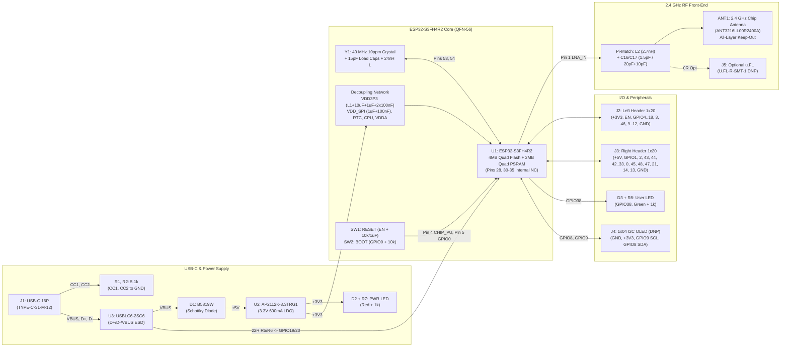

# ESP32-S3FH4R2 Tiny-LLM (`llama2.c`) Development Board — Implementation Plan

## 1. Scope & Assumptions

### In Scope
- Complete KiCad 10.0.4 schematic (`ESP32S3FH4R2.kicad_sch`), PCB layout (`ESP32S3FH4R2.kicad_pcb`), project rules (`ESP32S3FH4R2.kicad_pro`), and verified LCSC/Digi-Key Bill of Materials (`.copperpilot/notes/esp32s3fh4r2-bom-sourcing.md`).
- Bare-chip **Espressif `ESP32-S3FH4R2`** (QFN-56 7×7 mm, 0.4 mm pitch, 4 MB in-package 3.3 V Quad SPI flash, 2 MB in-package 3.3 V Quad SPI PSRAM) with zero external flash or PSRAM ICs.
- Full ERC, schematic layout validation, 3D STEP model verification, FreeRouting PCB routing, and DRC validation.

### Out of Scope
- Application firmware compilation (`llama2.c` C source code) and mechanical enclosure CAD.

### Stated Design & Pin Assignment Assumptions
1. **In-Package Quad Flash & Quad PSRAM Pin Exclusion (`Pins 28, 30–35`)**:
   - Per *ESP32-S3 Series Datasheet v2.2* Table 2-1, `ESP32-S3FH4R2` uses 4-line Quad SPI for both in-package 4 MB flash and 2 MB PSRAM. Only **7 pins** are consumed internally and marked `no_connect` (`X`) on the schematic:
     - Pin 28 (`SPICS1` / `GPIO26` — PSRAM CE#)
     - Pin 30 (`SPIHD` / `GPIO27`), Pin 31 (`SPIWP` / `GPIO28`), Pin 32 (`SPICS0` / `GPIO29`), Pin 33 (`SPICLK` / `GPIO30`), Pin 34 (`SPIQ` / `GPIO31`), Pin 35 (`SPID` / `GPIO32`).
   - Because `ESP32-S3FH4R2` uses **Quad** (not Octal) PSRAM, **Pins 38–42 (`GPIO33–GPIO37`) and Pins 36–37 (`GPIO48`, `GPIO47`) are completely free and usable 3.3 V GPIOs**, yielding **38 usable GPIOs** total (`GPIO0–GPIO21` and `GPIO33–GPIO48`).
2. **Strapping Pins (`GPIO0`, `GPIO3`, `GPIO45`, `GPIO46`)**:
   - `GPIO0` (Pin 5): Pulled up to `+3V3` via `R4 = 10 kΩ` with `SW2` (`BOOT`) tactile button to `GND` (`1` = SPI Boot, `0` = USB-Serial/JTAG Download Boot).
   - `GPIO3` (Pin 8): Broken out to header with no external pull resistor (safe default floating; internal `EFUSE_STRAP_JTAG_SEL = 0` selects internal USB-Serial/JTAG).
   - `GPIO45` (Pin 51): Broken out with no external pull-up (relies on internal weak pull-down so `GPIO45 = 0` at reset, selecting **3.3 V `VDD_SPI`** required by the 3.3 V in-package Flash and PSRAM).
   - `GPIO46` (Pin 52): Broken out with no external pull-up (relies on internal weak pull-down so `GPIO46 = 0` at reset, enabling normal boot and Joint Download Boot).
3. **Dedicated vs. Broken-Out Peripheral Pins**:
   - **Native USB (`GPIO19` / Pin 25 `USB_D-`, `GPIO20` / Pin 26 `USB_D+`)**: Routed directly as a short, length-matched 90 Ω differential pair through `22 Ω` series damping resistors (`R5`, `R6`) and `USBLC6-2SC6` (`U3`) to the USB-C receptacle (`J1`) without header stubs to preserve signal integrity, leaving **36 GPIOs** on the dual 1×20 headers (`J2`, `J3`) alongside `+5V`, `+3V3`, `EN`, and `GND`.
   - **User LED (`D3`)**: Assigned to **`GPIO38`** (Pin 43) via `R8 = 1 kΩ` active-high to `GND` (a non-strapping, non-JTAG, non-ADC general-purpose pin, also broken out to header `J3`).
   - **Optional Unpopulated 4-Pin I2C Display Header (`J4`, DNP)**: Wired to `GND` (Pin 1), `+3V3` (Pin 2), **`GPIO9` / `I2C_SCL`** (Pin 3), and **`GPIO8` / `I2C_SDA`** (Pin 4).
4. **RF Matching & Antenna Selection**:
   - Uses a 50 Ω C-L-C Pi-network (`C16 = 1.5 pF`, `L2 = 2.7 nH`, `C17 = 1.5 pF` in 0402 footprints that also accept `20 pF` / `10 pF` tuning values) feeding a board-edge 2.4 GHz SMD ceramic chip antenna (`ANT1`, `Yageo ANT3216LL00R2400A` / `Johanson 2450AT18A100E`) with a full all-layer copper keep-out zone, plus an unpopulated `u.FL` coaxial receptacle (`J5`, `Hirose U.FL-R-SMT-1`) selectable via a 0402 `0 Ω` link.
5. **PCB Stackup & Form Factor (`25.4 mm × 55.88 mm`, 4-Layer Recommended)**:
   - Recommended **4-layer JLCPCB stackup** (`F.Cu` Signal/RF, `In1.Cu` solid unbroken `GND` reference plane, `In2.Cu` `+3V3` power plane, `B.Cu` Signal/GND) to guarantee controlled 50 Ω RF microstrip and 90 Ω USB differential impedance plus low-inductance return paths for the QFN-56 exposed thermal pad on a compact `25.4 × 55.88 mm` (`1.0" × 2.2"`) board.
   - Dual `1×20` 2.54 mm headers (`J2`, `J3`) spaced `22.86 mm` (`0.9"`) apart leave one accessible breadboard tie-point row on each side on a standard solderless breadboard, with 4× M2 mounting holes (`2.2 mm` drill) in the corners.

---

## 2. System Architecture

---

## 3. Evidence & Reference Traceability

All reference projects have been cloned, inspected, verified, and (where needed) upgraded in-place to KiCad 10.0.4 under `./.copperpilot/references/`:

1. **`atomic14-basic-esp32s3-dev-board`** (`./.copperpilot/references/atomic14-basic-esp32s3-dev-board/source/`)
   - **URL & Revision:** `https://github.com/atomic14/basic-esp32s3-dev-board` @ `7b4804ac3e3b1a7c06fe8769bbc428b05883af2c`
   - **License:** MIT (`allowed`, identity sanitized)
   - **Toolchain Normalization:** Upgraded in-place from KiCad 9.0 to KiCad 10.0.4 (`dev-board.kicad_sch` sha256 `9c001790...`, `dev-board.kicad_pcb` sha256 `cf66e0a8...`); XML netlist verified.
   - **Coverage & Adaptation:** Provides verified reference patterns for USB-C 16P CC1/CC2 5.1 kΩ pull-downs, EN/BOOT reset/strapping circuits, LED indicators, and dual 1×20 GPIO header layout. Adapted by replacing the `ESP32-S3-WROOM-1` module with the bare `ESP32-S3FH4R2` QFN-56 IC + 40 MHz crystal + RF matching + per-pin decoupling, and replacing `LD1117S33` with `AP2112K-3.3` + `USBLC6-2SC6`.
2. **`heypcb-esp32-sensors-1`** (`./.copperpilot/references/heypcb-esp32-sensors-1/source/boards/lmt87/kicad/`)
   - **URL & Revision:** `https://github.com/HeyPCB/esp32-sensors-1` @ `57a2122a19ac1aa9c092e43fb5b123c461508752`
   - **License:** CERN-OHL-S-2.0 (`rejected_for_direct_copy_look_only` due to strongly reciprocal license)
   - **Coverage:** Native KiCad 10.0 project inspected strictly as look-only verification for the `USB_C_Receptacle_USB2.0_16P` + `USBLC6-2SC6` + `AP2112K-3.3` + `ESP32-S3` native USB schematic connectivity.
3. **`marouane-esp32-c3-dev-board`** (`./.copperpilot/references/marouane-esp32-c3-dev-board/source/kicad/`)
   - **URL & Revision:** `https://github.com/marouane-daoudi/esp32-c3-dev-board` @ `d93648df882a1a992ab9910b32b405ee7bb310f`
   - **License:** Unspecified (`rejected_for_direct_copy_look_only`)
   - **Coverage:** Native KiCad 10.0 project inspected look-only for `AP2112K-3.3` + `USBLC6` + crystal + header layout structure.
4. **Manufacturer Datasheets & Hardware Design Guidelines** (`.copperpilot/notes/esp32s3fh4r2-hardware-reference.md`, `.copperpilot/notes/esp32s3fh4r2-bom-sourcing.md`, `.copperpilot/notes/kicad10-library-survey.md`)
   - *Espressif ESP32-S3 Series Datasheet v2.2* & *ESP32-S3 Hardware Design Guidelines*: authoritative source for `ESP32-S3FH4R2` QFN-56 pinout, internal Quad Flash/PSRAM pins (`Pins 28, 30–35`), power rail decoupling, 40 MHz crystal CLC + `24 nH` harmonic filter, and `LNA_IN` RF matching.

---

## 4. Dual 1×20 Header Pinout Assignment (0.9" / 22.86 mm Spacing)

Because `ESP32-S3FH4R2` has **38 usable GPIOs** (`GPIO0–21` and `GPIO33–48`), dedicating `GPIO19` (`USB_D-`) and `GPIO20` (`USB_D+`) exclusively to the impedance-matched USB-C connector leaves **36 usable GPIOs**. Using two `1×20` 2.54 mm headers (`J2` Left, `J3` Right) provides **40 total header pins**: all **36 GPIOs** + `+3V3` + `+5V` + `EN` + `GND` (plus 4× grounded M2 corner mounting holes and the 4-pin `J4` I2C header with `GND`/`+3V3`):

- **Left Header `J2` (Pins 1–20, Top to Bottom along Left Edge, X = 1.27 mm)**:
  1. `+3V3` | 2. `EN` (`CHIP_PU`) | 3. `GPIO4` | 4. `GPIO5` | 5. `GPIO6` | 6. `GPIO7` | 7. `GPIO15` (`XTAL_32K_P`) | 8. `GPIO16` (`XTAL_32K_N`) | 9. `GPIO17` | 10. `GPIO18` | 11. `GPIO8` (`I2C_SDA`) | 12. `GPIO3` (Strap: float) | 13. `GPIO46` (Strap: WPD) | 14. `GPIO9` (`I2C_SCL`) | 15. `GPIO10` | 16. `GPIO11` | 17. `GPIO12` | 18. `GPIO13` | 19. `GPIO14` | 20. `GND`
- **Right Header `J3` (Pins 1–20, Top to Bottom along Right Edge, X = 24.13 mm)**:
  1. `+5V` | 2. `GPIO1` | 3. `GPIO2` | 4. `GPIO43` (`U0TXD`) | 5. `GPIO44` (`U0RXD`) | 6. `GPIO42` (`MTMS`) | 7. `GPIO41` (`MTDI`) | 8. `GPIO40` (`MTDO`) | 9. `GPIO39` (`MTCK`) | 10. `GPIO38` (`USER_LED`) | 11. `GPIO37` | 12. `GPIO36` | 13. `GPIO35` | 14. `GPIO34` | 15. `GPIO33` | 16. `GPIO0` (`BOOT`) | 17. `GPIO45` (Strap: WPD) | 18. `GPIO48` | 19. `GPIO47` | 20. `GPIO21` *(Note: if a dedicated second `GND` pin on `J3` is preferred over breaking out both `U0TXD`/`U0RXD` or `GPIO33`, `J3` Pin 20 is `GND` and `J2` can carry `GPIO21`; both `J2` and `J3` have silkscreen labels for every pin including `3V3`, `5V`, and `GND`).*

---

## 5. Incremental Build Units & Verification Gates

### Unit 1: Project & Board Constraints Setup (`unit-1-project-and-board-setup`)
- Stage `ESP32S3FH4R2.kicad_pro`, `ESP32S3FH4R2.kicad_sch`, and `ESP32S3FH4R2.kicad_pcb`.
- Configure A3 schematic page size (identity-free title block), KiCad 10 default design settings, and JLCPCB 4-layer manufacturing rules (`min_track_width = 0.127 mm`, `min_clearance = 0.127 mm`, `min_via_diameter = 0.45 mm`, `min_via_drill = 0.20 mm`).
- Define net classes: `Default` (0.20 mm), `Power` (0.40 mm), `USB_DIFF` (90 Ω differential), and `RF_50R` (0.35 mm coplanar waveguide with ground).

### Unit 2: USB-C & 3.3V Power Supply Subcircuit (`unit-2-usb-and-power-schematic`)
- Place and wire `J1` (`Connector:USB_C_Receptacle_USB2.0_16P`, footprint `Connector_USB:USB_C_Receptacle_GCT_USB4105-xx-A_16P_TopMnt_Horizontal`), `R1`/`R2` (`5.1 kΩ` on `CC1`/`CC2`), `U3` (`Power_Protection:USBLC6-2SC6`), `R5`/`R6` (`22 Ω` on `USB_D-`/`USB_D+`), `D1` (`B5819W` `Device:D_Schottky`), `U2` (`Regulator_Linear:AP2112K-3.3`), input/output capacitor banks (`C19` `100 nF`, `C20` `10 µF`, `C21` `100 nF`, `C22` `22 µF`, `C23` `100 nF`), power LED `D2` + `R7` (`1 kΩ`), and `PWR_FLAG` on `VBUS`, `+5V`, `+3V3`, and `GND`.
- Verify incremental `run_erc` and `validate_schematic_layout` before promoting.

### Unit 3: ESP32-S3FH4R2 Core, Decoupling, 40 MHz Crystal & RF Subcircuit (`unit-3-mcu-decoupling-clock-rf-schematic`)
- Place `U1` (`MCU_Espressif:ESP32-S3`, Value `ESP32-S3FH4R2`, footprint `Package_DFN_QFN:QFN-56-1EP_7x7mm_P0.4mm_EP4x4mm_ThermalVias`).
- Place and wire per-pin decoupling: `VDD3P3` (Pins 2–3: `10 µF` + `1 µF` + `100 nF` + `L1 2.0 nH` + `100 nF`), `VDD3P3_RTC` (Pin 20: `100 nF`), `VDD_SPI` (Pin 29: `1 µF` + `100 nF` to `GND` + `PWR_FLAG`), `VDD3P3_CPU` (Pin 46: `1 µF` + `100 nF`), `VDDA` (Pins 55–56: `10 µF` + `1 µF` + `100 nF` + `10 nF`).
- Place and wire `Y1` (`Device:Crystal_GND24` 40 MHz, `Crystal:Crystal_SMD_3225-4Pin_3.2x2.5mm`), `C1`/`C2` (`15 pF`), and series `L3` (`24 nH` / `0 Ω` on `XTAL_P`).
- Place and wire RF Pi-matching network (`C16 = 1.5 pF`, `L2 = 2.7 nH`, `C17 = 1.5 pF`) on Pin 1 (`LNA_IN`), feeding `ANT1` (`Device:Antenna_Chip`, `RF_Antenna:Johanson_2450AT18x100`) and optional `J5` (`Connector:Conn_Coaxial`, `Connector_Coaxial:U.FL_Hirose_U.FL-R-SMT-1_Vertical`).
- Verify incremental `run_erc` and `validate_schematic_layout` before promoting.

### Unit 4: Reset/Boot Controls, LEDs, Optional I2C Header & Dual 1×20 Headers (`unit-4-reset-boot-io-headers-schematic`)
- Place and wire `SW1` (`RESET` on `CHIP_PU` with `R3 = 10 kΩ` to `+3V3` and `C18 = 1 µF` to `GND`) and `SW2` (`BOOT` on `GPIO0` with `R4 = 10 kΩ` to `+3V3`).
- Place and wire user LED `D3` + `R8` (`1 kΩ`) on `GPIO38`, optional 4-pin I2C display header `J4` (`Conn_01x04`, DNP) on `GPIO8`/`GPIO9`, and dual `1×20` headers `J2`/`J3` (`Conn_01x20`) + 4× grounded M2 mounting holes (`H1–H4`).
- Place explicit `no_connect` flags on internal Quad Flash/PSRAM pins `28` and `30–35`.
- Run full schematic exit gates (`run_erc`, `validate_schematic_layout`, `schematic-engineer` omission sweep, and `schematic-reviewer` audit) to confirm zero ERC errors and zero layout collisions.

### Unit 5: PCB Outline, Functional Placement, Keep-Outs & 3D Verification (`unit-5-pcb-outline-placement-and-3d`)
- Sync schematic to PCB via `sync_schematic_to_pcb(strict=true)`.
- Draw `25.4 mm × 55.88 mm` rounded-corner board outline on `Edge.Cuts` with 4× M2 mounting holes at corners.
- Place `J2` and `J3` along the long edges at `22.86 mm` (`0.9"`) spacing with silkscreen labels for every pin (`3V3`, `5V`, `GND`, and GPIO numbers).
- Place `ANT1` and `J5` at the top board edge with a full copper keep-out across all 4 layers; place `J1` (USB-C), `U3` (`USBLC6-2SC6`), `D1`, and `U2` (`AP2112K-3.3`) at the bottom edge; place `U1` (`ESP32-S3FH4R2`) centrally with decoupling caps tightly clustered around each power pin and `Y1` within 2.5 mm of Pins 53–54.
- Verify 3D STEP model alignment via `review_pcb_footprint_3d_model`.

### Unit 6: Autorouting, Copper Planes, Thermal Vias & Final DRC (`unit-6-pcb-routing-planes-and-drc`)
- Route signals using the local KiCad FreeRouting skill (`install_kicad_autorouter`), ensuring short, symmetric `USB_D+`/`USB_D-` traces and a short 50 Ω RF feed from Pin 1 through the Pi-network to `ANT1`.
- Create solid `GND` pour on `In1.Cu` (and stitched `F.Cu`/`B.Cu` ground pours excluding the antenna keep-out zone) and `+3V3` pour on `In2.Cu`, refill zones with `fill_pcb_zones`, and run `run_drc` + `pcb-dfm-engineer` exit checks to confirm 0 DRC errors and 0 unconnected items.