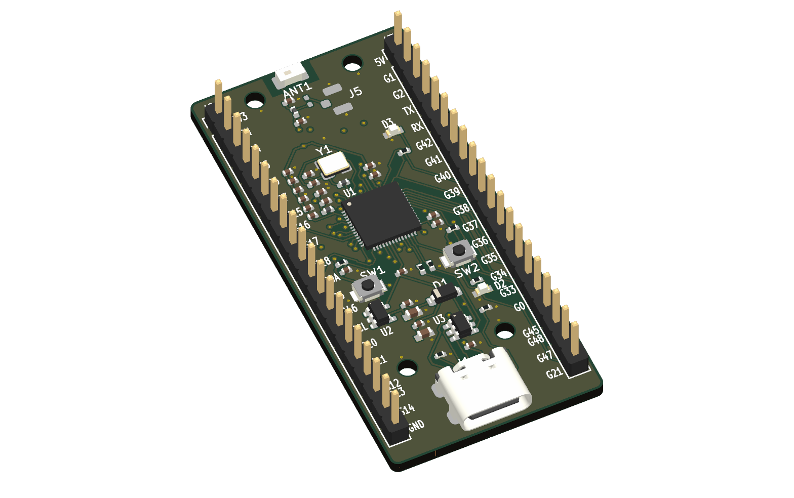
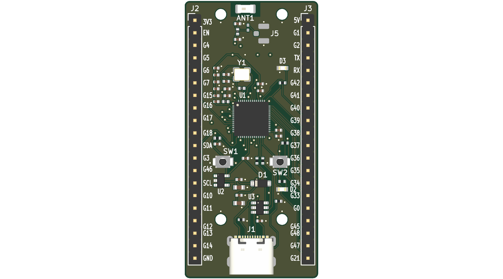
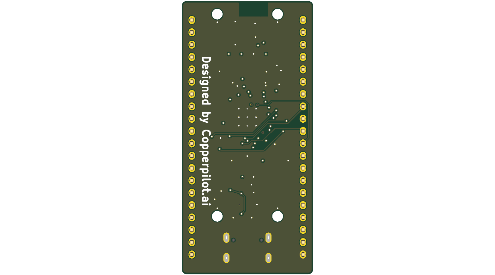
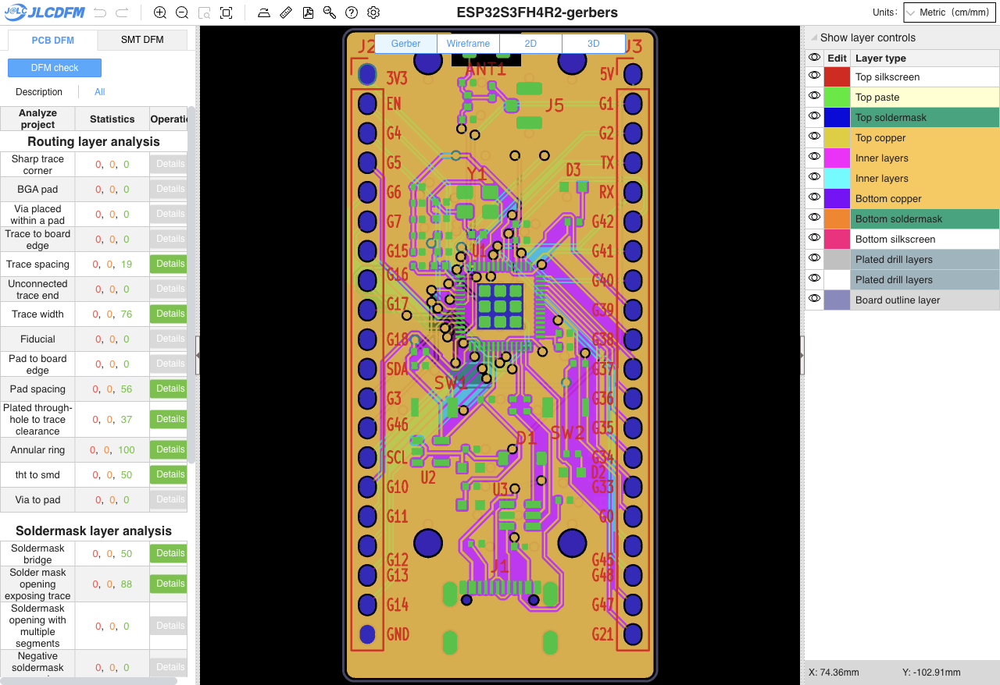

# ESP32-S3FH4R2 Tiny-LLM Development Board

A compact, 4-layer, breadboard-friendly (`27.00 × 56.20 mm`, `0.9"` / `22.86 mm` row spacing) development board engineered around the **Espressif `ESP32-S3FH4R2`** SoC (`QFN-56 7×7 mm`, **4 MB in-package Quad SPI Flash** + **2 MB in-package Quad SPI PSRAM**) for running embedded LLM inference workloads such as **`llama2.c` (260K-parameter model)** at 240 MHz.

---

## Visual Overview

| Isometric 3D Render | Top Copper & Assembly Render | Bottom Silkscreen & Plane Render |
|---|---|---|
|  |  |  |

---

## Validation & Manufacturing Readiness Summary

| Verification Suite | Tool / Platform | Result | Errors / Dangers | Warnings | Status |
|---|---|---|---|---|---|
| **Schematic ERC** | `kicad-cli sch erc` (KiCad 10.0.4) | **PASS** | `0` | `0` | 100% Clean |
| **Schematic Layout Audit** | CopperPilot `validate_schematic_layout` | **PASS** | `0` | `0` | 100% Clean |
| **PCB Design Rules Check (DRC)** | `kicad-cli pcb drc` (KiCad 10.0.4) | **PASS** | `0` (`0` unconnected) | `0` | 100% Routed (70 nets, 221 pads) |
| **Schematic-to-PCB Netlist Parity** | XML Netlist vs `.kicad_pcb` Audit | **PASS** | `0` mismatches | `0` | 54/54 Footprints, 221/221 Pins Matched |
| **JLCPCB Live DFM (JLCDFM)** | `jlcdfm.com` (27-Check 4-Layer Suite) | **PASS** | **`0` Dangers** | **`0` Warnings** | **27 / 27 Checks Passed** |
| **Lion Circuits Turnkey DFM** | `lioncircuits-order preflight` | **PASS** | `0` | `0` | Meets 6/6 mil, 0.30 mm drill, 6 mil ring |
| **Lion Circuits BOM Scrub** | `order.lioncircuits.com` Live Inventory | **PASS** | `0` Out of Stock | `0` | **28 / 28 BOM Rows Ready to Procure** |

---

## Hardware Architecture

### 1. MCU & In-Package Quad Memory (`U1` — `ESP32-S3FH4R2`)
- **Processor:** Dual-core 32-bit Xtensa LX7 microprocessor running up to **240 MHz** with vector instructions for neural network and DSP acceleration.
- **In-Package Memory:** **4 MB Quad SPI Flash** + **2 MB Quad SPI PSRAM** integrated inside the `7 × 7 mm` `QFN-56` package, powered internally from the 3.3 V `VDD_SPI` domain (Pin 29).
- **Dedicated Internal Memory Pins (Do Not Route Externally):**
  - Pins `28` (`SPICS1` / `GPIO26`), `30` (`SPIHD` / `GPIO27`), `31` (`SPIWP` / `GPIO28`), `32` (`SPICS0` / `GPIO29`), `33` (`SPICLK` / `GPIO30`), `34` (`SPIQ` / `GPIO31`), and `35` (`SPID` / `GPIO32`) are dedicated exclusively to the in-package Quad Flash and Quad PSRAM and are left strictly unconnected (`no_connect`) on both the schematic and PCB.
  - Because the `ESP32-S3FH4R2` uses **4-line Quad SPI** (not 8-line Octal SPI), `GPIO33–GPIO37` (Pins 38–42) and `GPIO47–GPIO48` (Pins 36–37) remain **100% free and available** as general-purpose 3.3 V I/Os, yielding **38 usable GPIOs** in total.

### 2. Clock Generation & 2.4 GHz RF Front-End
- **40 MHz Crystal Oscillator (`Y1`):** Seiko Epson `TSX-3225 40.0000MF15Y-K0` (`3.2 × 2.5 mm` 4-pin SMD, `±10 ppm`, `CL = 12 pF`) placed adjacent to Pins 53/54 (`XTAL_N`/`XTAL_P`) with `15 pF` C0G load capacitors (`C1`, `C2`) and a `24 nH` high-Q series inductor (`L3`, Murata `LQW15AN24NJ00D`) on `XTAL_P` for harmonic suppression.
- **2.4 GHz RF Matching & Antenna (`ANT1`, `J5`):**
  - 50 Ω C-L-C Pi-matching network (`C16 = 1.5 pF`, `L2 = 2.7 nH` Murata `LQG15HS2N7S02D`, `C17 = 1.5 pF`) connected to `LNA_IN` (Pin 1).
  - Edge-mounted 2.4 GHz SMD ceramic chip antenna (`ANT1`, Yageo `ANT3216LL00R2400A`) positioned at the top board edge with a complete **all-layer (`F.Cu`, `In1.Cu`, `In2.Cu`, `B.Cu`) copper and via keep-out zone** (`x = 108.5..114.5 mm`, `y = 99.6..102.8 mm`) and coplanar ground fencing vias.
  - Optional unpopulated `u.FL` coaxial receptacle (`J5`, Hirose `U.FL-R-SMT-1(10)`) via 0 Ω RF path selector pad (`R9`).

### 3. USB 2.0 Type-C & Native USB-Serial/JTAG Programming
- **USB-C Receptacle (`J1`):** GCT `USB4105-GF-A` 16-pin horizontal top-mount USB 2.0 Type-C connector.
- **USB Type-C Sink Configuration:** Independent `5.1 kΩ ±1%` pull-down resistors (`R1` on `CC1`, `R2` on `CC2`) to `GND` for compliant 5 V USB-C upstream host detection across both cable orientations.
- **ESD Protection (`U3`):** STMicroelectronics `USBLC6-2SC6` (`SOT-23-6`) low-capacitance (`2.5 pF typ`) rail-to-rail TVS array protecting `D+`, `D-`, and `VBUS` (`C23 = 100 nF` local `VBUS` bypass at Pin 5).
- **Native USB Data Path:** `D-` (`GPIO19`, Pin 25) and `D+` (`GPIO20`, Pin 26) routed as a matched 90 Ω differential pair through `22 Ω ±1%` series damping resistors (`R5`, `R6`). Supports direct firmware flashing, serial console logging, and JTAG debugging via `idf.py -p <PORT> flash monitor` with no external USB-UART bridge IC required.

### 4. Power Supply & Multi-Domain Decoupling
- **Reverse-Current Protection (`D1`):** Diodes Inc `1N5819HW-7-F` (`40 V`, `1 A` SOD-123 Schottky rectifier) in series between `VBUS` and `+5V`.
- **3.3 V 600 mA LDO Regulator (`U2`):** Diodes Inc `AP2112K-3.3TRG1` (`SOT-23-5`, `600 mA` continuous output, `250 mV` typical dropout at `600 mA`) sized for dual-core 240 MHz execution with simultaneous Wi-Fi/BLE TX bursts.
  - **LDO Input Filtering (`+5V`):** `C20 = 10 µF` (0603 X5R) + `C19 = 100 nF` (0402 X7R).
  - **LDO Output Reservoir (`+3V3`):** `C22 = 22 µF` (0603 X5R) + `C21 = 100 nF` (0402 X7R) + Red 0603 Power-On LED (`D2`, `R7 = 1 kΩ`).
- **Espressif Hardware Design Guideline Decoupling Network:**
  - **`VDD3P3` RF PA Supply (Pins 2, 3):** Pi-filter with `L1 = 2.0 nH` (`LQG15HS2N0S02D`), upstream bulk/bypass `C3 = 10 µF` + `C4 = 1 µF` + `C5 = 100 nF`, and downstream `C6 = 100 nF` right at Pins 2/3.
  - **`VDD3P3_RTC` Supply (Pin 20):** `C7 = 100 nF` local bypass.
  - **`VDD_SPI` In-Package Flash/PSRAM Rail (Pin 29):** `C8 = 1 µF` + `C9 = 100 nF` local decoupling to `GND`.
  - **`VDD3P3_CPU` Digital Core/IO Supply (Pin 46):** `C10 = 1 µF` + `C11 = 100 nF` local bypass.
  - **`VDDA` Analog/PLL/Crystal Supply (Pins 55, 56):** `C12 = 10 µF` + `C13 = 1 µF` + `C14 = 100 nF` + `C15 = 10 nF`.

### 5. Boot/Reset Controls, Strapping Pins & User I/O
- **Chip Enable / Reset (`EN` / `CHIP_PU`, Pin 4):** `R3 = 10 kΩ` pull-up to `+3V3` and `C18 = 1 µF` delay capacitor to `GND` (`τ = 10 ms` power-on reset delay per Espressif datasheet), plus top-actuated SMD tactile `RESET` switch (`SW1`, Omron `B3U-1000P`) to `GND`.
- **Boot Mode Control (`GPIO0`, Pin 5):** `R4 = 10 kΩ` pull-up to `+3V3` and SMD tactile `BOOT` switch (`SW2`, Omron `B3U-1000P`) to `GND`.
- **Safe Strapping Pin Defaults:**
  - `GPIO0` (Pin 5): Pulled high (`10 kΩ` `R4`) for SPI Flash boot; pulled low via `SW2` for Joint Download Boot (USB-Serial/JTAG / UART0).
  - `GPIO3` (Pin 8): Left floating at reset (default JTAG source selection).
  - `GPIO45` (Pin 51): **CRITICAL — Must remain low (unpulled) at reset** so internal weak pull-down selects `VDD_SPI = 3.3 V` for the in-package 3.3 V 4 MB Quad Flash and 2 MB Quad PSRAM.
  - `GPIO46` (Pin 52): Left low at reset via internal weak pull-down.
- **User Status LED (`D3`):** Active-high Green 0603 LED (`LTST-C190KGKT`) with `R8 = 1 kΩ` current-limiting resistor driven by `GPIO38` (Pin 43).
- **Optional I2C OLED Header (`J4`, DNP):** 4-pin 2.54 mm header (`+3V3`, `GND`, `I2C_SCL` on `GPIO9`, `I2C_SDA` on `GPIO8`).

---

## Dual 1×20 Header Pinout (`0.9"` / `22.86 mm` Breadboard Spacing)

All 36 remaining usable GPIOs (plus `EN`, `+3V3`, `+5V`, and `GND`) are broken out to `J2` (Left) and `J3` (Right) with explicit silkscreen labels:

| Pin # | Left Header (`J2`) Signal | MCU Pin / Function | Right Header (`J3`) Signal | MCU Pin / Function | Pin # |
|---|---|---|---|---|---|
| **1** | `+3V3` | 3.3 V LDO Output (`600 mA`) | `+5V` | 5 V Protected USB Rail (via `D1`) | **1** |
| **2** | `EN` | Pin 4 (`CHIP_PU` Active-Low Reset) | `GPIO1` | Pin 6 (`ADC1_CH0` / `TOUCH1`) | **2** |
| **3** | `GPIO4` | Pin 9 (`ADC1_CH3` / `TOUCH4`) | `GPIO2` | Pin 7 (`ADC1_CH1` / `TOUCH2`) | **3** |
| **4** | `GPIO5` | Pin 10 (`ADC1_CH4` / `TOUCH5`) | `U0TXD` | Pin 49 (`GPIO43` / `UART0_TX`) | **4** |
| **5** | `GPIO6` | Pin 11 (`ADC1_CH5` / `TOUCH6`) | `U0RXD` | Pin 50 (`GPIO44` / `UART0_RX`) | **5** |
| **6** | `GPIO7` | Pin 12 (`ADC1_CH6` / `TOUCH7`) | `GPIO42` | Pin 48 (`MTMS` / JTAG TMS) | **6** |
| **7** | `GPIO15` | Pin 21 (`XTAL_32K_P` / `ADC2_CH4`) | `GPIO41` | Pin 47 (`MTDI` / JTAG TDI) | **7** |
| **8** | `GPIO16` | Pin 22 (`XTAL_32K_N` / `ADC2_CH5`) | `GPIO40` | Pin 45 (`MTDO` / JTAG TDO) | **8** |
| **9** | `GPIO17` | Pin 23 (`U1TXD` / `ADC2_CH6`) | `GPIO39` | Pin 44 (`MTCK` / JTAG TCK) | **9** |
| **10** | `GPIO18` | Pin 24 (`U1RXD` / `ADC2_CH7`) | `GPIO38` | Pin 43 (`USER_LED` Active-High) | **10** |
| **11** | `GPIO8` | Pin 13 (`I2C_SDA` / `ADC1_CH7`) | `GPIO37` | Pin 42 (`FSPIQ` — Free on FH4R2) | **11** |
| **12** | `GPIO3` | Pin 8 (`ADC1_CH2` / Strapping) | `GPIO36` | Pin 41 (`FSPICLK` — Free on FH4R2) | **12** |
| **13** | `GPIO46` | Pin 52 (Strapping — Keep Low at Boot) | `GPIO35` | Pin 40 (`FSPID` — Free on FH4R2) | **13** |
| **14** | `GPIO9` | Pin 14 (`I2C_SCL` / `ADC1_CH8`) | `GPIO34` | Pin 39 (`FSPICS0` — Free on FH4R2) | **14** |
| **15** | `GPIO10` | Pin 15 (`FSPICS0` / `ADC1_CH9`) | `GPIO33` | Pin 38 (`FSPIHD` — Free on FH4R2) | **15** |
| **16** | `GPIO11` | Pin 16 (`FSPID` / `ADC2_CH0`) | `GPIO0` | Pin 5 (`BOOT` Button / Strapping) | **16** |
| **17** | `GPIO12` | Pin 17 (`FSPICLK` / `ADC2_CH1`) | `GPIO45` | Pin 51 (`VDD_SPI` Strap — Keep Low!) | **17** |
| **18** | `GPIO13` | Pin 18 (`FSPIQ` / `ADC2_CH2`) | `GPIO48` | Pin 36 (`SPICLK_N` — Free on FH4R2) | **18** |
| **19** | `GPIO14` | Pin 19 (`FSPIWP` / `ADC2_CH3`) | `GPIO47` | Pin 37 (`SPICLK_P` — Free on FH4R2) | **19** |
| **20** | `GND` | Ground Reference | `GPIO21` | Pin 27 (`RTC_GPIO21`) | **20** |

---

## 4-Layer PCB Stackup & Physical Specifications

| Parameter | Specification |
|---|---|
| **Board Dimensions** | `27.00 × 56.20 mm` (`1.063" × 2.213"`), `1.0 mm` corner radius, 4× M2 mounting holes (`H1`–`H4`) |
| **Layer 1 (`F.Cu`)** | Top Signal, 50 Ω RF CPWG feed, 90 Ω USB 2.0 differential pair, component pads + stitched `GND` pour |
| **Layer 2 (`In1.Cu`)** | Unbroken solid `GND` reference plane (with antenna keep-out under `ANT1`) |
| **Layer 3 (`In2.Cu`)** | Solid `+3V3` power distribution plane (with antenna keep-out under `ANT1`) |
| **Layer 4 (`B.Cu`)** | Bottom Signal escape routing + solid stitched `GND` pour and bottom silkscreen artwork |
| **Dielectric Stackup** | `1.6 mm` FR-4 standard 4-layer stackup (`0.10–0.20 mm` prepreg to `In1.Cu` `GND` reference) |
| **Minimum Trace / Space** | `0.155 mm` (`6.1 mil`) signal width (`0.20–0.40 mm` power), `0.1524 mm` (`6.0 mil`) minimum clearance |
| **Via Geometry** | `0.61 mm` pad diameter / `0.30 mm` drill (`0.155 mm` / `6.1 mil` annular ring), 67 vias total |
| **Thermal Design** | `9×` plated thermal vias in `U1` Pad 57 (`4.0 × 4.0 mm` exposed pad) tied directly to `In1.Cu` and `B.Cu` `GND` planes (specify 50–60% windowed stencil paste coverage on `U1` Pad 57 for assembly) |

---

## Bill of Materials (BOM)

The full machine-readable BOM CSVs are provided at [`ESP32S3FH4R2-BOM.csv`](./ESP32S3FH4R2-BOM.csv) (all 28 line items / 50 electrical parts) and [`fab/ESP32S3FH4R2-bom-populated-only.csv`](./fab/ESP32S3FH4R2-bom-populated-only.csv) (25 populated line items / 47 parts).

| Item | Designator | Qty | Value | Package / Footprint | MPN | Manufacturer | LCSC # | Digi-Key # | Status |
|---|---|---|---|---|---|---|---|---|---|
| 1 | `U1` | 1 | `ESP32-S3FH4R2` | `QFN-56-1EP_7x7mm_P0.4mm_EP4x4mm` | `ESP32-S3FH4R2` | Espressif Systems | `C3013940` | `1965-ESP32-S3FH4R2CT-ND` | Populate |
| 2 | `U2` | 1 | `AP2112K-3.3` | `SOT-23-5` | `AP2112K-3.3TRG1` | Diodes Incorporated | `C51118` | `AP2112K-3.3TRG1DICT-ND` | Populate |
| 3 | `U3` | 1 | `USBLC6-2SC6` | `SOT-23-6` | `USBLC6-2SC6` | STMicroelectronics | `C7519` | `497-5235-1-ND` | Populate |
| 4 | `Y1` | 1 | `40MHz` | `Crystal_SMD_3225-4Pin_3.2x2.5mm` | `TSX-3225 40.0000MF15Y-K0` | Seiko Epson | `C255942` | `SER4097CT-ND` | Populate |
| 5 | `ANT1` | 1 | `ANT3216LL00R2400A` | `1206` (`3.2x1.6mm` Chip Antenna) | `ANT3216LL00R2400A` | Yageo / Pulse | `C293767` | `13-ANT3216LL00R2400ACT-ND` | Populate |
| 6 | `J1` | 1 | `USB-C 16P` | `USB_C_Receptacle_GCT_USB4105-xx-A_16P` | `USB4105-GF-A` | GCT | `C165948` | `2073-USB4105-GF-ACT-ND` | Populate |
| 7 | `D1` | 1 | `B5819W` | `D_SOD-123` | `1N5819HW-7-F` | Diodes Incorporated | `C8598` | `1N5819HW-7-FDICT-ND` | Populate |
| 8 | `D2` | 1 | `Red` (PWR) | `LED_0603_1608Metric` | `LTST-C190KRKT` | Lite-On | `C2286` | `160-1447-1-ND` | Populate |
| 9 | `D3` | 1 | `Green` (GPIO38) | `LED_0603_1608Metric` | `LTST-C190KGKT` | Lite-On | `C12624` | `160-1446-1-ND` | Populate |
| 10 | `SW1, SW2` | 2 | `RESET / BOOT` | `SW_SPST_B3U-1000P` | `B3U-1000P` | Omron Electronics | `C145958` | `SW1020CT-ND` | Populate |
| 11 | `L1` | 1 | `2.0nH` | `L_0402_1005Metric` | `LQG15HS2N0S02D` | Murata | `C15132` | `490-14573-1-ND` | Populate |
| 12 | `L2` | 1 | `2.7nH` | `L_0402_1005Metric` | `LQG15HS2N7S02D` | Murata | `C27123` | `490-14577-1-ND` | Populate |
| 13 | `L3` | 1 | `24nH` | `L_0402_1005Metric` | `LQW15AN24NJ00D` | Murata | `C76878` | `490-1155-1-ND` | Populate |
| 14 | `C1, C2` | 2 | `15pF` | `C_0402_1005Metric` | `CC0402JRNPO9BN150` | Yageo | `C1548` | `311-1019-1-ND` | Populate |
| 15 | `C16, C17` | 2 | `1.5pF` | `C_0402_1005Metric` | `CC0402CRNPO9BN1R5` | Yageo | `C1552` | `311-1010-1-ND` | Populate |
| 16 | `C15` | 1 | `10nF` | `C_0402_1005Metric` | `CL05B103KB5NNNC` | Samsung Electro-Mechanics | `C15195` | `1276-1009-1-ND` | Populate |
| 17 | `C5–C7, C9, C11, C14, C19, C21, C23` | 9 | `100nF` | `C_0402_1005Metric` | `CL05B104KO5NNNC` | Samsung Electro-Mechanics | `C1525` | `1276-1000-1-ND` | Populate |
| 18 | `C4, C8, C10, C13, C18` | 5 | `1uF` | `C_0402_1005Metric` | `CL05A105KP5NNNC` | Samsung Electro-Mechanics | `C52923` | `1276-1006-1-ND` | Populate |
| 19 | `C3, C12` | 2 | `10uF` (6.3V) | `C_0402_1005Metric` | `CL05A106MQ5NUNC` | Samsung Electro-Mechanics | `C15525` | `1276-1089-1-ND` | Populate |
| 20 | `C20` | 1 | `10uF` (10V) | `C_0603_1608Metric` | `CL10A106MP8NNNC` | Samsung Electro-Mechanics | `C19702` | `1276-1099-1-ND` | Populate |
| 21 | `C22` | 1 | `22uF` (10V) | `C_0603_1608Metric` | `CL10A226MP8NUNE` | Samsung Electro-Mechanics | `C59461` | `1276-1119-1-ND` | Populate |
| 22 | `R1, R2` | 2 | `5.1k` | `R_0402_1005Metric` | `RC0402FR-075K1L` | Yageo | `C25905` | `311-5.10KLRCT-ND` | Populate |
| 23 | `R3, R4` | 2 | `10k` | `R_0402_1005Metric` | `RC0402FR-0710KL` | Yageo | `C25744` | `311-10.0KLRCT-ND` | Populate |
| 24 | `R5, R6` | 2 | `22` | `R_0402_1005Metric` | `RC0402FR-0722RL` | Yageo | `C25092` | `311-22.0LRCT-ND` | Populate |
| 25 | `R7, R8` | 2 | `1k` | `R_0402_1005Metric` | `RC0402FR-071KL` | Yageo | `C11702` | `311-1.00KLRCT-ND` | Populate |
| 26 | `J2, J3` | 2 | `HEADER_1x20` | `PinHeader_1x20_P2.54mm_Vertical` | `M20-9992046` | Harwin | `C2839521` | `952-2273-ND` | Populate |
| 27 | `J4` | 1 | `I2C_OLED_DNP` | `PinHeader_1x04_P2.54mm_Vertical` | `TSW-104-07-L-S` | Samtec | `C2839481` | `SAM1029-04-ND` | DNP |
| 28 | `J5` | 1 | `U.FL_DNP` | `U.FL_Hirose_U.FL-R-SMT-1_Vertical` | `U.FL-R-SMT-1(10)` | Hirose Electric | `C88373` | `H9161CT-ND` | DNP |
| 29 | `R9` | 1 | `0R_DNP` | `R_0402_1005Metric` | `RC0402JR-070RL` | Yageo | `C17168` | `311-0.0LRCT-ND` | DNP |

---

## Repository Structure & Engineering Documentation

### Primary KiCad 10 Design Files
- [`ESP32S3FH4R2.kicad_pro`](./ESP32S3FH4R2.kicad_pro) — KiCad 10 project configuration & DRC rules (`0.1524 mm` clearance, `0.155 mm` min track, `0.61/0.30 mm` vias).
- [`ESP32S3FH4R2.kicad_sch`](./ESP32S3FH4R2.kicad_sch) — Single-sheet hierarchical-framed schematic (`run_erc`: 0 errors, 0 warnings).
- [`ESP32S3FH4R2.kicad_pcb`](./ESP32S3FH4R2.kicad_pcb) — 4-layer routed PCB layout (`run_drc`: 0 errors, 0 warnings, 0 unconnected items).

### Ready-to-Upload Fabrication & Assembly Packages
- [`ESP32S3FH4R2-gerbers.zip`](./ESP32S3FH4R2-gerbers.zip) (also in [`fab/ESP32S3FH4R2-gerbers.zip`](./fab/ESP32S3FH4R2-gerbers.zip)) — 14-file 4-layer Gerber + Excellon drill archive verified on JLCPCB JLCDFM (`27/27 PASS`) and Lion Circuits.
- [`fab/ESP32S3FH4R2-gerbers-with-drill-maps.zip`](./fab/ESP32S3FH4R2-gerbers-with-drill-maps.zip) — Complete Gerber + Excellon archive bundled with Gerber X2 and PDF drill maps (`fab/gerbers/`).
- [`ESP32S3FH4R2-BOM.csv`](./ESP32S3FH4R2-BOM.csv) & [`fab/ESP32S3FH4R2-bom-populated-only.csv`](./fab/ESP32S3FH4R2-bom-populated-only.csv) — Turnkey PCBA Bill of Materials CSVs.
- [`ESP32S3FH4R2-CPL-XY.csv`](./ESP32S3FH4R2-CPL-XY.csv) & [`fab/ESP32S3FH4R2-cpl-populated-only.csv`](./fab/ESP32S3FH4R2-cpl-populated-only.csv) — Pick-and-Place XY Centroid CSVs.

### Engineering Notes, Validation Reports & Provenance (`.copperpilot/`)
- **Consolidated DFM & Validation Report:** [`.copperpilot/notes/final-dfm-validation-report.md`](./.copperpilot/notes/final-dfm-validation-report.md)
- **Multidisciplinary Board Validation Audit (SI/PI/EMC/Thermal/DFM/IPC):** [`.copperpilot/notes/board-validation-report.md`](./.copperpilot/notes/board-validation-report.md)
- **Final Design Deliverables, Pinout & BOM Guide:** [`.copperpilot/notes/final-design-deliverables.md`](./.copperpilot/notes/final-design-deliverables.md)
- **Lion Circuits DFM & Live Inventory Report:** [`.copperpilot/notes/lioncircuits-dfm-bom-report.md`](./.copperpilot/notes/lioncircuits-dfm-bom-report.md)
- **Manufacturing Export File Manifest:** [`.copperpilot/notes/manufacturing-export-files.md`](./.copperpilot/notes/manufacturing-export-files.md)
- **ESP32-S3FH4R2 Datasheet & Pinout Reference:** [`.copperpilot/notes/esp32s3fh4r2-hardware-reference.md`](./.copperpilot/notes/esp32s3fh4r2-hardware-reference.md)
- **LCSC & Digi-Key Component Sourcing Reference:** [`.copperpilot/notes/esp32s3fh4r2-bom-sourcing.md`](./.copperpilot/notes/esp32s3fh4r2-bom-sourcing.md)
- **Schematic Review & Drafting Cleanup Log:** [`.copperpilot/notes/schematic-review-and-cleanup.md`](./.copperpilot/notes/schematic-review-and-cleanup.md)
- **KiCad 10 Library & 3D Model Audit:** [`.copperpilot/notes/kicad10-library-survey.md`](./.copperpilot/notes/kicad10-library-survey.md)
- **Hardware Implementation Plan:** [`.copperpilot/plans/esp32s3fh4r2-llm-dev-board.plan.md`](./.copperpilot/plans/esp32s3fh4r2-llm-dev-board.plan.md)
- **Design Oracle & Gate Records:** [`.copperpilot/oracle/design-oracle.json`](./.copperpilot/oracle/design-oracle.json), [`.copperpilot/oracle/provenance.jsonl`](./.copperpilot/oracle/provenance.jsonl), [`.copperpilot/oracle/gates.json`](./.copperpilot/oracle/gates.json)
